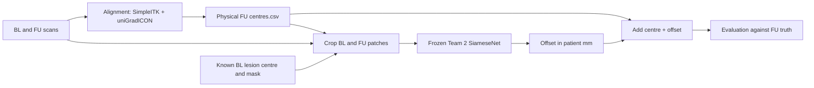

# Joint alignment and lesion localisation experiment

Branch: `karl-joint-alignment-localisation`. This integrates Team 1 (`bad1a5d`)
with Karl's Team 2 branch (`fd6de92`). The experiment can train a fresh Team 2
model or evaluate an existing checkpoint. The alignment stage stays independent.

Question: does a frozen Team 2 checkpoint improve Team 1's predicted centres on
real registration residuals, and how does it compare with dataset propagation?
The previously reported 5.58 mm Team 2 result used simulated FU jitter and is
not an expected or measured result for this experiment.

## Independent stages



- `registration.py`, `team1_register.py`, `team1_unigradicon.py` produce alignment
  transforms and centres. Registration environments remain separate from the
  lesion model environment. Reuse their cached outputs for the first run.
- `alignment.py` defines the strict `CentreTable` boundary and the hybrid gate:
  uniGradICON IO=50 within 25 mm of local, otherwise local. No FU truth enters
  that decision. Local centres must exist; missing candidate centres fall back.
- `prediction.py` owns checkpoint loading and plain / eight-flip TTA inference.
  Inputs are BL CT, FU CT and the BL lesion mask; output is an `(x,y,z)` offset
  in millimetres. The unused FU-mask channel is zero. The network is not trained
  or updated during this experiment. Other predictors can implement the same
  `predict(bl_patch, fu_patch, bl_mask_patch)` method.
- `pipeline.py` composes the stages. Its `LesionQuery` contains only the BL
  lesion location and identifiers. It never receives FU truth or FU masks.
- `joint_eval.py` reads scans once per pair per alignment, calls the pipeline and
  scores predictions. FU truth is used only here for metrics and window coverage.

All centres are SimpleITK physical patient coordinates, `(x,y,z)` millimetres.
Arrays have `(z,y,x)` axes. Patches retain Team 2's patient-aligned 64³ grid at
2 mm spacing and its intensity normalisation; no scanner direction is applied
again when adding the predicted offset.

## Inputs

Run from a checkout of this branch on the cluster, using the existing lesion
venv (`numpy`, `pandas`, `SimpleITK`, `torch`). Defaults:

| Input | Path |
|---|---|
| Raw scans + official `data_split.json` | `/gpfs/helios/projects/ml_project_lesion_tracking/data` |
| All eligible lesion metadata | `$RAW/team1/lesions.csv` |
| Selected hybrid centres | `$RAW/team1/centres.csv` |
| Frozen Team 2 run 6b | `runs/3288501/best.pt` |

Run 6b uses BL mask input, template size 5, no centre prior. Match those settings
if overriding `CKPT`. The existing state_dict format does not record training
arguments, so changing checkpoint also requires checking the model flags.
This experiment reports plain and TTA readouts without selecting a new model.

The generated files and trained checkpoint are cluster artifacts; they are not
included by this branch. For a first run use the existing hybrid centres rather
than rerunning the expensive alignment models. To regenerate alignment, use
the existing Team 1 jobs documented in `docs/wiki/Teams.md`, then
`PYTHONPATH=src python scripts/team1_combine.py "$RAW/team1" --tau 25`.
Only do that in a separate output directory if preserving the original outputs.

## Run

### Restart training from scratch (recommended when the old checkpoint is unavailable)

```bash
mkdir -p logs
sbatch scripts/train_joint.sbatch
```

This starts a new SiameseNet from random weights with the run 6b configuration:
50 epochs, batch 16, AdamW learning rate 3e-4, train-only offline augmentation,
fresh 8 mm FU jitter, BL mask input, mask-loss weight 0.5, EMA 0.999 and template
size 5. It uses the existing prepared data, never loads an old checkpoint, and
keeps the test split untouched. Reusing Team 1's cached alignment outputs does
not reuse Team 2 weights; uniGradICON remains a separate pretrained aligner.

After training, the **same job** automatically runs the three-lesion joint smoke
test and, if that succeeds, the full validation comparison. Outputs are new and
never overwrite previous runs:

```text
runs/joint-restart-JOBID/model/best.pt
runs/joint-restart-JOBID/smoke/summary.csv
runs/joint-restart-JOBID/validation/summary.csv
```

Check progress with `tail -f logs/joint-restart-JOBID.out`. The first phase logs
training epochs; later phases print the smoke and validation tables. Training
command and Git state are recorded beside the new checkpoint. The training
data format, patient splits and alignment-centre coverage are checked before
training starts. `RAW`, `TEAM1`, `DATA`, `AUG_DATA`, `VENV`, `OUT`, `TRAIN_EPOCHS`
and `BATCH_SIZE` can be overridden in the submission environment. Defaults
expect `$RAW/Longitudinal-CT-processed-team2` and its `-aug` sibling.

If the prepared data is missing or lacks `fu_big` / `fu_mask_big`, regenerate it
with the existing independent CPU jobs, then submit training after both succeed:

```bash
prep_job=$(sbatch --parsable scripts/preprocess_team2.sbatch)
aug_job=$(sbatch --parsable scripts/augment_team2.sbatch)
sbatch --dependency=afterok:"$prep_job":"$aug_job" scripts/train_joint.sbatch
```

Those preparation jobs use their existing output defaults; set `RAW` and `OUT`
when submitting them if your data lives elsewhere. They do not recompute Team 1
alignment. No training or cluster evaluation has been launched by Codex locally.

### Evaluate an existing checkpoint

```bash
mkdir -p logs
sbatch scripts/evaluate_joint.sbatch --limit 3   # wiring check, not a result
sbatch scripts/evaluate_joint.sbatch             # complete validation experiment
```

`RAW`, `TEAM1`, `CKPT`, `OUT` and `VENV` can be set in the submission environment.
Use a new output directory for every run. For example:

```bash
CKPT=/path/to/run6b/best.pt sbatch scripts/evaluate_joint.sbatch
```

Without Slurm (CPU is supported):

```bash
PYTHONPATH=src python scripts/evaluate_joint.py \
  --raw "$RAW" --lesions "$RAW/team1/lesions.csv" \
  --centres "$RAW/team1/centres.csv" --ckpt runs/3288501/best.pt \
  --out runs/joint-val-smoke --device cpu --limit 3
```

The default is `val`, with the official patient split checked for overlap and
against the lesion table. The test split requires both `--split test` and
`--allow-test`; reserve it for a final frozen configuration. `--limit` marks the
manifest as a smoke test, even if it happens to cover the whole split.

## Comparisons and outputs

Every method uses the exact same eligible lesion cohort:

1. `propagated`: dataset propagation alone (BL physical-coordinate fallback
   when missing, matching Team 1's baseline accounting).
2. `hybrid`: selected Team 1 centres alone.
3. `hybrid_plain`, `hybrid_tta`: Team 1 centres + frozen Team 2 offsets.
4. `propagated_plain`, `propagated_tta`: dataset centres + the same frozen model.

`predictions.csv` records each method's point, centre, truth, error, window
coverage, propagation availability, status and any prediction failure.
`summary.csv` reports mean/median error, CPM@5/10/20 (fractions), axis errors,
patient-averaged mean error, sample count and fallback count.
`manifest.json` records arguments, Git commit/dirty state, input/checkpoint
hashes, cohort sizes, Torch version and completion status.

There is **no 56 mm filter** and no requirement for FU masks. This avoids the
previous preprocessing cohort mismatch (Team 1 val 208 vs Team 2 val 207).
Missing BL masks, failed scan reads or inference failures explicitly retain the
alignment-only point, stay in the denominator and are reported as fallbacks.
Any prediction fallback makes the CLI exit nonzero after saving diagnostics.
Missing/duplicate/non-finite supplied alignment centres fail before inference;
there is no silent substitution with a different alignment method.

Inspect fallback counts and all large regressions before interpreting a mean.
Compare paired per-lesion errors and patient means, since lesions from one
patient are not independent. A lower combined validation error than hybrid alone
is evidence that Team 2 helps with real alignment residuals. No improvement is
also useful: it would motivate a separate training experiment using train-only
registration residuals, especially their wider z-axis distribution.

## Local checks

```bash
OMP_NUM_THREADS=1 PYTHONPATH=src python -m pytest -q
bash -n scripts/evaluate_joint.sbatch
```

Tests include flipped scan directions and anisotropic spacing, CSV key/coverage
validation, centre-plus-offset composition, FU-label isolation, XYZ TTA sign
handling, out-of-window/failure accounting, merged preprocessing with masks, and
an actual CLI run using a synthetic scan and an explicitly random test-only
checkpoint. Synthetic checks validate wiring; they provide no accuracy result.

Status: implementation and local synthetic tests only. The cluster validation
experiment has not been submitted or measured from this checkout.
