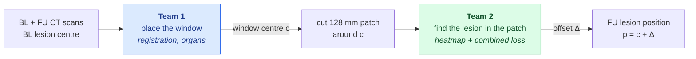

# Teams

We split the problem into two parts and the four of us into two teams of two. Each team starts with the simplest
working version and adds complexity one step at a time. Every step is one run, logged as one row in [[Experiments]].

## Why two teams

Experiment 1 (branch `first_e2e_pipeline`, job 2961900) tried to do everything in one model: a CNN that sees the
BL and FU patches and regresses the lesion offset. It did not beat the registration guess
(val mean error 14.37 mm vs 14.51 mm for predicting zero). The task has two different sub-problems, and we now
treat them separately:



How to read it:
- **Team 1** turns the whole scans into one window centre `c`. Its error is `‖true − c‖`, the error of the zero baseline.
  If that error is over 56 mm on any axis, the lesion is outside the patch and nothing downstream can fix it.
- **Team 2** only ever sees the 128 mm patches and predicts the remaining offset `Δ`.
- **Overall error** is `‖true − (c + Δ)‖`. A better `c` makes Team 2's job easier; a good `Δ` corrects the rest.

**Interface between the teams:** Team 1 delivers `centres.csv` with columns `patient, lesion, x_mm, y_mm, z_mm`
(patient coordinates, same convention as `preprocess.py`). Preprocessing then uses these centres instead of
`cog_propagated`. Until then Team 2 trains on today's patches, so neither team waits for the other.

## Team 1: placing the window

Members: Gerdo Germann, Imre Saks. Branch `team1`.

**Goal:** put the FU window (64 × 64 × 64 voxels of 2 mm, i.e. a 128 mm cube) so that the lesion sits roughly in its centre. The distance from
the window centre to the true FU lesion centre (`‖target_mm‖`) should be as small as possible. At minimum the lesion
must fall inside the window: each axis within 56 mm. Today 167 lesions are dropped because they fall outside
(`skip_outside_window` in `logs/prep-2630226.out`). Reusing the BL coordinates does not work: patient position,
breathing and scan range differ between the two scans.

**Allowed inputs:** the BL and FU scans, and the BL lesion position and mask. `cog_propagated` is the reference to
beat, not an input.

**Scored on all eligible lesions**, not only the 2502 npz patches: `lesions.csv` keeps the same filter as
`preprocess.py` (UNCHANGED/MERGING, linking clear, both centres known) but not the 56 mm check, because keeping those
lesions inside the window is Team 1's job. Nothing here is trained, so settings (mesh size, K, σ, λ) are chosen on
train and reported on val; test only for final numbers.

**Metrics:** `window_metrics` in `src/lesionloc/metrics.py` (Imre's `compute_metrics` plus `In window@56`: share of
lesions with every axis within 56 mm, the same rule as `skip_outside_window`). `scripts/team1_eval.py` prints one
markdown row per split and method for [[Experiments]]; `--by-type` splits val by `lesion_type` (Lung, Liver, Lymph node, ...).

**Steps, simple to complex.** Each step writes one centres file `centres/<method>.csv` (`patient, lesion, x_mm, y_mm, z_mm`):

| Step | Method | Model | Code | centres file |
|---|---|---|---|---|
| 0 | same mm coordinates as BL | none | `team1_lesions.py` | `bl` |
| 1 | `cog_propagated` from the dataset: **the bar to beat** | dataset's registration | `team1_lesions.py` | `propagated` |
| 2a | rigid whole-scan registration (6 DoF) | SimpleITK, Mattes MI in a body mask | `team1_register.py` | `rigid` |
| 2b | affine whole-scan registration (12 DoF) | SimpleITK | `team1_register.py` | `affine` |
| 2c | affine + rigid correction in a 160 mm cube around each lesion | SimpleITK | `team1_register.py` | `local` |
| 3a | shift by the host organ's BL → FU centroid shift (else nearest organ) | TotalSegmentator (117 structures) | `team1_organs.py` | `organ_shift` |
| 3b | local affine from the K nearest organs, weights exp(−d/σ), ridge λ towards a pure shift | TotalSegmentator | `team1_organs.py` | `organ_affine_k*_s*_l*` |
| 4 | deformable B-spline on top of affine | SimpleITK | `team1_register.py` | `bspline8` |
| 5 | pretrained deformable registration, with and without instance optimisation | uniGradICON (Tian et al. 2024) | `team1_unigradicon.py` | `ugi_ioNone`, `ugi_io50` |
| 5c | `ugi_io50` when within 25 mm of `local`, else `local` | uniGradICON + SimpleITK | `team1_combine.py` | `hybrid_ugi_local` |
Later, if time allows (no code yet):
- **SAM, Self-supervised Anatomical eMbedding** (Yan et al. 2022): find the point in FU whose embedding matches the BL lesion. Deep Lesion Tracker uses it to place its window.
- **VISTA3D** or MONAI `wholeBody_ct_segmentation`: alternative organ masks for step 3, if TotalSegmentator masks fail on some scans.
- **LesionLocator** (Rokuss et al. 2025, in `papers/`): zero-shot tracking of the whole task, an outside baseline for the final joint evaluation.

**Pitfalls built into the code:**
- Registration runs with fixed = BL and moving = FU, so the transform maps BL points to FU points (`tx.TransformPoint(bl_mm)`). `tests/test_team1.py` checks this on a shifted phantom.
- BL and FU often cover different body ranges, so rigid registration starts from the best of three starts (identity, image centres, body centroids), judged by the metric.
- An organ cut off by the scan border has a centroid that moves with the cut, so such organs are never used as landmarks.
- Tumours are often left out of their organ's mask, so the host organ is the most common label around the lesion when the lesion voxel itself is background.
- Patient ids are hex strings (`0640966322`): every csv is read with `patient` as text.

**Running it on the cluster.** All output goes to `/gpfs/helios/projects/ml_project_lesion_tracking/data/team1/`, group-writable:

```bash
sbatch scripts/team1_register.sbatch          # steps 0-2 and 4, CPU; PATIENTS=a,b for a quick check first
sbatch scripts/totalseg.sbatch                # GPU, once per scan, cached
sbatch --dependency=afterok:<totalseg id> scripts/team1_organs.sbatch   # step 3, CPU
sbatch scripts/unigradicon.sbatch             # step 5, GPU; then IO=50 sbatch scripts/unigradicon.sbatch
PYTHONPATH=src python scripts/team1_eval.py $T1/lesions.csv $T1/centres/*.csv --by-type
```

TotalSegmentator and uniGradICON each get their own venv (setup in the sbatch headers), so they cannot break the
training venv.

**Hand-over:** the best method's centres file is copied to `centres.csv`. Two things follow once Team 2's branch is on
`main`: `preprocess.py` gets a `--centre csv --centres-csv` mode that cuts the FU window there, and Team 2 compares its
training jitter (N(0, 8 mm) per axis) with Team 1's real val residuals before the joint evaluation.
**Hand-over:** `centres/hybrid_ugi_local.csv` (step 5c, τ = 25 mm) is copied to `$T1/centres.csv` (val mean 10.75 mm, median 6.71 mm, CPM@10 63.0%, 100% in window@56). `preprocess.py` now supports `--centre csv --centres-csv $T1/centres.csv` to cut the FU window there. Team 1's val residuals `(true_fu − c)` have per-axis standard deviations `(7.1, 8.2, 11.7) mm` (`(6.5, 6.5, 9.2) mm` on train) for `hybrid_ugi_local` and `(7.3, 8.8, 12.4) mm` for `local`, closely matching Team 2's N(0, 8 mm) training jitter on x and y with slightly larger z variance (~12 mm) along the axial scan direction.

## Team 2: finding the lesion in the patch

Members: Kristian Tamm, Karl Väärtnõu. Branch `team2-training-data`.

**Goal:** given a patch that is roughly in the right place, predict where the lesion is inside it
(`target_mm`, the offset from the patch centre). The bar is the zero baseline: val mean error 14.51 mm.

**Metrics:** `compute_metrics` and `scripts/baselines.py` (Imre's branch), and the val report printed by
`scripts/train.py`. Use the test split only for final numbers.

**Steps, simple to complex:**
0. Baselines: predict zero, and predict the train mean (`scripts/baselines.py`).
1. Direct regression with a Euclidean / smooth-L1 loss. Done in Experiment 1; it does not learn.
2. Siamese model: one shared encoder for BL and FU, correlation of the BL lesion features with every FU position
   gives a heatmap, and soft-argmax turns it into a point. Loss = Euclidean distance between that point and the true point.
3. Add a heatmap loss: compare the predicted heatmap with a Gaussian centred on the true point (MSE or cross-entropy).
4. Add the BL lesion mask as a third input channel, so the model knows which lesion to follow.
5. Add a mask loss: reward heatmap mass inside the FU lesion mask (e.g. `-log` of the summed probability inside the mask),
   or check whether the predicted point lies inside the mask.

The combined loss is `L = L_dist + λ_hm · L_heatmap + λ_mask · L_mask`. Add one term at a time and log the λ values
with each run.

**Data needed for steps 4–5:** today's npz files contain no masks. `preprocess.py` must also cut `bl_mask` and
`fu_mask` patches: nearest-neighbour resampling, keeping only this lesion's instance. First check the mask file names
in raw `inputsTr/` on the cluster.

## Shared rules

- **Patient split:** `split.json`, enforced by `LesionDataset` (`src/lesionloc/dataset.py`). No patient appears in two splits.
- **Experiments:** one change per experiment, every run logged in [[Experiments]].
- **Code:** shared code in `src/lesionloc/`, one branch per team.
- **Joint evaluation:** final error = ‖Team 1 centre + Team 2 offset − true FU position‖, compared against
  `cog_propagated` alone.
