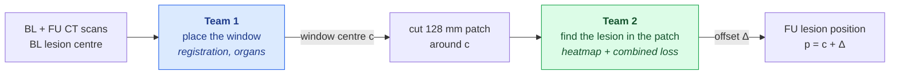

# Teams

We split the problem into two parts and the four of us into two teams of two. Each team starts with the simplest
working version and adds complexity one step at a time. Every step is one run, logged as one row in [[Experiments]].

## Why two teams

Experiment 1 (branch `first_e2e_pipeline`, job 2961900) tried to do everything in one model: a CNN that sees the
BL and FU patches and regresses the lesion offset. It did not beat the registration guess
(val mean error 14.37 mm vs 14.51 mm for predicting zero). The task has two different sub-problems, and we now
treat them separately:

How to read it:
- **Team 1** turns the whole scans into one window centre `c`. Its error is `‖true − c‖`, the error of the zero baseline.
  If that error is over 56 mm on any axis, the lesion is outside the patch and nothing downstream can fix it.
- **Team 2** only ever sees the 128 mm patches and predicts the remaining offset `Δ`.
- **Overall error** is `‖true − (c + Δ)‖`. A better `c` makes Team 2's job easier; a good `Δ` corrects the rest.

**Interface between the teams:** Team 1 delivers `centres.csv` with columns `patient, lesion, x_mm, y_mm, z_mm`
(patient coordinates, same convention as `preprocess.py`). Preprocessing then uses these centres instead of
`cog_propagated`. Until then Team 2 trains on today's patches, so neither team waits for the other.

## Team 1: placing the window

Members: _TBD_

**Goal:** put the FU window (64 × 64 × 64 voxels of 2 mm, i.e. a 128 mm cube) so that the lesion sits roughly in its centre. The distance from
the window centre to the true FU lesion centre (`‖target_mm‖`) should be as small as possible. At minimum the lesion
must fall inside the window: each axis within 56 mm. Today 167 lesions are dropped because they fall outside
(`skip_outside_window` in `logs/prep-2630226.out`). Reusing the BL coordinates does not work: patient position,
breathing and scan range differ between the two scans.

**Allowed inputs:** the BL and FU scans, and the BL lesion position and mask. `cog_propagated` is the reference to
beat, not an input.

**Metrics:** mean and median distance (mm) from window centre to true FU centre, share of lesions within 20 mm and
within 56 mm. `compute_metrics` in `src/lesionloc/metrics.py` (Imre's branch) works with
pred = window centre, true = FU centre.

**Steps, simple to complex:**
0. Same mm coordinates as in BL. Measure how bad this is; it is the number that motivates the team.
1. `cog_propagated` from the dataset (registration guess). This is the bar to beat.
2. Rigid or affine registration of the whole BL scan to the FU scan with SimpleITK (already a dependency).
3. Organs as landmarks, using TotalSegmentator (Wasserthal et al., University Hospital Basel) organ masks on both scans:
   - first, shift the window by the BL to FU centroid shift of the organ the lesion is in, or the nearest organ;
   - then, fit a local affine transform from several nearby organs.
4. Deformable registration (SimpleITK B-spline), optionally guided by the organ masks.

**Notes:** this works on the full scans (raw `inputsTr/`), not on the patches. Run TotalSegmentator once per scan as
a cluster job and cache the masks; do not recompute them in every experiment.

## Team 2: finding the lesion in the patch

Members: _TBD_

**Goal:** given a patch that is roughly in the right place, predict where the lesion is inside it
(`target_mm`, the offset from the patch centre). The bar is the zero baseline: val mean error 14.51 mm.

**Metrics:** `compute_metrics` and `scripts/baselines.py` (Imre's branch), and the val report printed by
`scripts/train.py`. Use the test split only for final numbers.

**Steps, simple to complex:**
0. Baselines: predict zero, and predict the train mean (`scripts/baselines.py`).
1. Direct regression with a Euclidean / smooth-L1 loss. Done in Experiment 1; it does not learn.
2. Siamese model: one shared encoder for BL and FU, correlation of the BL lesion features with every FU position
   gives a heatmap, and soft-argmax turns it into a point. Loss = Euclidean distance between that point and the true point.
3. Add a heatmap loss: compare the predicted heatmap with a Gaussian centred on the true point (MSE or cross-entropy).
4. Add the BL lesion mask as a third input channel, so the model knows which lesion to follow.
5. Add a mask loss: reward heatmap mass inside the FU lesion mask (e.g. `-log` of the summed probability inside the mask),
   or check whether the predicted point lies inside the mask.

The combined loss is `L = L_dist + λ_hm · L_heatmap + λ_mask · L_mask`. Add one term at a time and log the λ values
with each run.

**Data needed for steps 4–5:** today's npz files contain no masks. `preprocess.py` must also cut `bl_mask` and
`fu_mask` patches: nearest-neighbour resampling, keeping only this lesion's instance. First check the mask file names
in raw `inputsTr/` on the cluster.

## Shared rules

- **Patient split:** `split.json`, enforced by `LesionDataset` (`src/lesionloc/dataset.py`). No patient appears in two splits.
- **Experiments:** one change per experiment, every run logged in [[Experiments]].
- **Code:** shared code in `src/lesionloc/`, one branch per team.
- **Joint evaluation:** final error = ‖Team 1 centre + Team 2 offset − true FU position‖, compared against
  `cog_propagated` alone.
